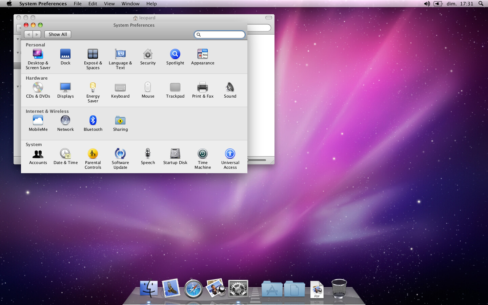
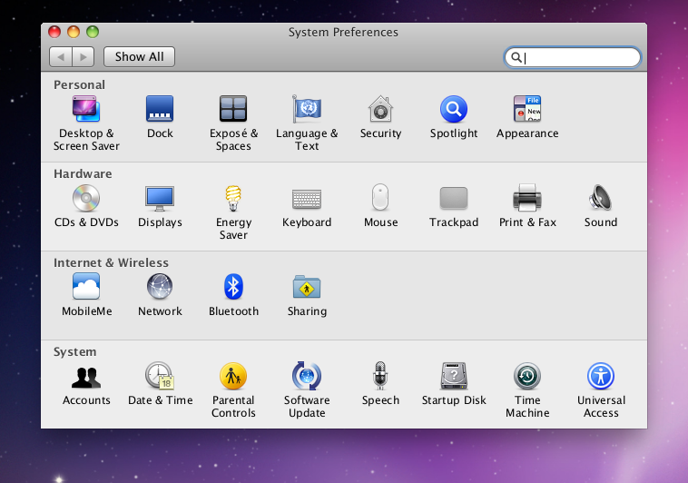
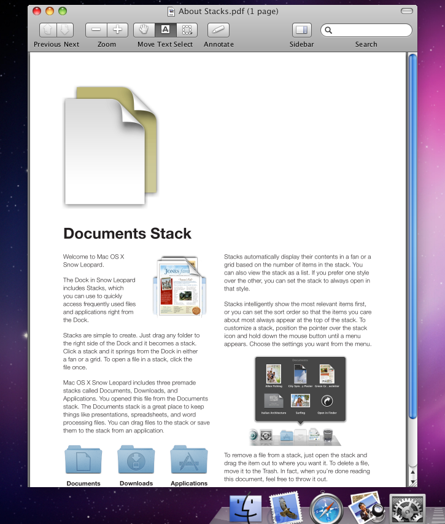
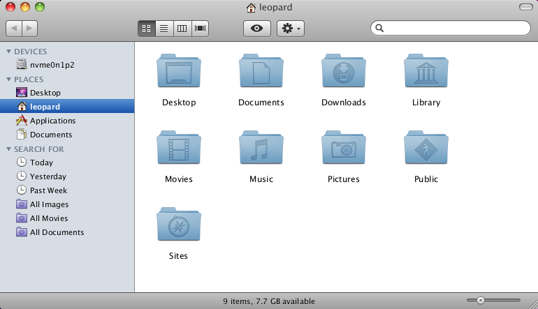

<div align="center">

# Snow Leopard

**Mac OS X 10.6's desktop, rebuilt as native Linux programs.**

The Dock, the menu bar, the Finder, the window server, System Preferences, Preview:
each one a program of its own, laid out as on the Mac.

[](LICENSE)


<br>



</div>

---

No Mac code runs. Your own Snow Leopard install DVD only gives the shell its **resources**
(icons, the Dock's glass floor, the menu extras' art, Lucida Grande, the desktop pictures, the
nibs, the strings), read at run time. The behaviour is rebuilt from the frameworks' code
([docs/reverse-status.md](docs/reverse-status.md)) and from those resources.

It follows the same idea as Winedows' native shell (XP) and the Aqua session of TigerInstaller
(10.4): every part of the Mac's shell is its own program, at its Mac path
(`Dock.app/Contents/MacOS/Dock`, `SystemUIServer.app/...`, `Finder.app/...`).

> [!NOTE]
> **Personal, experimental project.** Tried on CachyOS only. Try it in a window first.

## Contents

- [The programs](#the-programs)
- [Quick start](#quick-start)
- [What works now](#what-works-now)
- [Settings](#settings)
- [How it is made](#how-it-is-made)
- [License](#license)

## The programs

| Program | What it is | Built on |
|---|---|---|
| **SystemUIServer** | The menu bar: the Apple menu, the applications' menus, the menu extras | Qt 6 |
| **Dock** | The 3D glass Dock, Stacks, magnification, its dark menus | Qt 6 |
| **WindowServer** | The window manager and compositor: 10.6's title bars and shadows | Qt 6, xcb |
| **Finder** | The desktop picture, and the browser windows in all four views | Qt 6 / AquaKit |
| **System Preferences** | Show All and every pane, built from its own nib | AquaKit |
| **Preview** | PDFs and pictures in 10.6's document window | AquaKit, poppler |
| **loginwindow** | About This Mac | AquaKit |
| **Software Update** | Mac OS X 10.6.8, from Apple's own catalog | AquaKit |
| **Mail** | Early: IMAP and SMTP, passwords in the desktop's keyring | AquaKit, libcurl, libsecret |
| **Stickies** | Stickies 7.0: its database, its notes' colours and frames, Arrange, Find, Import and Export | AquaKit |
| **TextEdit** | TextEdit 1.6: rich and plain text, RTF and RTFD, Make Plain / Rich Text, the ruler, Wrap to Page, Find, Preferences | AquaKit |

**AquaKit** is the Mac's frameworks without Qt, each its own library shared by the programs as on
the Mac: Foundation, CoreGraphics (PNG, JPEG, TIFF, icns and PDF pictures, poppler drawing the PDFs),
CoreText, CoreUI (its own renderer, reversed) and AppKit, on cairo and pango, on Wayland or X11.

**Text** is drawn as Quartz draws it: Lucida Grande's unhinted outlines, made heavier by Quartz's
own font smoothing dilation, then its LCD smoothing (the red, green and blue filters and the gamma
mix reversed from CoreGraphics). `SNOWLEOPARD_FONT_SMOOTHING=0` keeps the text grey.

<div align="center">
<table>
<tr>
<td align="center" valign="top"><br><sub><b>System Preferences</b>, every pane from its own nib</sub></td>
<td align="center" valign="top"><br><sub><b>Preview</b>, PDFs drawn by poppler</sub></td>
</tr>
</table>
</div>

## Quick start

Dependencies (Arch / CachyOS):

```sh
sudo pacman -S --needed cmake qt6-base qt6-imageformats libxcb xcb-util-keysyms cairo pango libjpeg-turbo libtiff lcms2 zlib libxkbcommon wayland wayland-protocols poppler-glib 7zip cpio python-xlib
```

Then, in a window of your current desktop (Xephyr, or Xwayland's window under Wayland):

```sh
./sl.sh ~/Downloads/snowleopard.iso       # the first time: takes the DVD's files, builds, runs
./sl.sh --                                # later
./sl.sh -- 1600x1000                      # at a size
```

Nothing on your system is touched: the DVD's files and the build go to `.local/`, and the session
has a home of its own, `.local/home/<you>` (Desktop, Documents, Downloads... as a new 10.6 account
has them; `SL_HOME=$HOME ./sl.sh --` to use yours).
`tools/extract.py` keeps only what the shell reads (about 150 MB in `.local/assets`) and the
DVD's HFS+ partition in `.local/media/MacOSX.hfs` (6 GB), from which it can extract again without
the DVD (`tools/extract.py .local/media/MacOSX.hfs`): delete it when you're done extracting.

<details>
<summary><b>Running one application by itself</b></summary>

System Preferences and Preview (AquaKit) also run by themselves on a Wayland desktop, with
10.6's title bar drawn by AquaKit (`AQUAKIT_PLATFORM=x11` to keep them on X11):

```sh
SNOWLEOPARD_ASSETS=$PWD/.local/assets ".local/build/apps/System Preferences.app/Contents/MacOS/System Preferences"
SNOWLEOPARD_ASSETS=$PWD/.local/assets .local/build/apps/Preview.app/Contents/MacOS/Preview file.pdf
```

</details>

<details open>
<summary><b>From the login screen</b></summary>

Once the DVD's files are taken (`./sl.sh` above), `install.sh` builds the shell and installs it,
with the files, in `/usr/local/lib/snowleopard`, and adds **Snow Leopard** to the login screen
(SDDM, GDM, Plasma Login, LightDM...). It asks for `sudo` for the copy.

```sh
./install.sh                # build, install, the login screen's entry
./install.sh --uninstall    # all of it away again
```

Without Xorg (a Wayland-only system), the entry starts KWin (or cage) alone as the compositor, a
full-screen Xwayland at the screen's size, and the session in it; with Xorg, a second entry runs
the session on its own X server. Restart and Shut Down act on the computer there. Log Out ends it.

</details>

<details>
<summary><b>As a whole X session</b></summary>

Put `exec /path/to/session/snowleopard-session` in `~/.xinitrc`.
Restart and Shut Down only act on the computer with `SNOWLEOPARD_POWER=1`.

</details>

## What works now

### The menu bar

- The **Apple menu**: About This Mac, System Preferences, Dock ▸, Recent Items, Force Quit,
  Sleep, Restart, Shut Down, Log Out.
- The active application's name in bold and its menus: the Finder's own (File, Edit, View, Go,
  Window, Help), and for the others Hide, Hide Others, Show All, Quit, Close Window, Minimize
  and the window list. Sliding along the bar with a menu open goes from menu to menu.
- **The applications' own menus**, over D-Bus (the global menu: Qt and KDE applications by
  themselves, GTK ones through appmenu-gtk-module).
- **Menu extras**: Spotlight (finds applications for now), the clock, the battery, the volume
  (a slider, through `pactl`), AirPort (the networks with their bars, joining with AirPort's own
  password, Join Other and Create Network panels from the DVD's nibs, Turn AirPort Off, through
  NetworkManager and `iw`) and Bluetooth (the devices and their submenus, Discoverable, a phone's
  network, the diagnostics report, through `bluetoothctl`), as 10.6.8's AirPort.menu and
  Bluetooth.menu make them.
- The bar is **translucent**, made from the desktop as 10.6's window server makes it (its menu
  bar filter, reversed from CoreGraphics and QuartzCore).
  `AppleEnableMenuBarTransparency=false` in `~/.config/snowleopard/menubar.conf` makes it
  opaque, as 10.6 without a graphics card.

### The Dock

<div align="center"></div>

- The 3D glass floor and its front line, the reflections, the separator, the running lights,
  the names over the icons, magnification and hiding, the bounce while an application starts.
- **Stacks** (Applications, Documents, Downloads): the pile of the latest documents with the
  Mac's icons, opening as a fan, a grid or a list, sorted as you choose. Downloads hops when a
  file arrives.
- Its dark menus (Options ▸ Keep in Dock / Remove from Dock, Open, Hide, Quit, Empty Trash),
  reordering by dragging, dragging out to remove, files dropped on an application or on the
  Trash.
- Its first contents are a new 10.6 account's (the DVD's `default.plist`).

### WindowServer

10.6's title bars with CoreUI's close, minimize and zoom buttons (glyphs on hover, inactive
windows grey), moving, resizing from the corner, double-click to minimize, zoom, full screen,
⌘W ⌘M ⌘H ⌘Q ⌘Tab (Super is Command).

It is the display's compositor too: 10.6's **shadows** under the windows, the panels and the
menus, made as 10.6's window server makes them (the outline blurred by its tent filter, its rim
and its gamma, the key window's deeper than the others'), and real translucency for the Dock
and its stacks.

### The Finder

<div align="center"></div>

- **The desktop**: the desktop picture with its placement, and **its icons**: the disks
  (as Preferences asks) and the Desktop folder's items, on the Finder's own grid (from the top
  right, column by column), moved and kept where you put them (the Desktop folder's `.DS_Store`),
  selected by a click or a rectangle, opened, renamed, labelled; dragged into a Finder window or
  from one onto the desktop; their contextual menus (Open, Open With ▸, Move to Trash or Eject,
  Get Info, Compress, Duplicate, Make Alias, Quick Look, Copy, Label:) and the desktop's (New
  Folder where you clicked, Change Desktop Background…, Clean Up, Arrange By ▸, Show View Options
  for the desktop's icon size, spacing and labels); the menu bar's commands and the keys apply to
  them while the desktop is in front.
- **The browser window**, without Qt, laid out by the Finder's own nibs and grid: the toolbar
  (Back/Forward, the view buttons, Quick Look, Action, Search) with CoreUI's template images,
  the sidebar (DEVICES, PLACES, SEARCH FOR) in the source list's colours, icons from CoreTypes
  with previews of pictures, selection, the status bar ("14 items, 7.87 GB available").
- **All four views**:
  - *Icons*, on the Finder's grid.
  - *List*: its columns from `ListView.nib` (Name, Date Modified, Size, Kind), folders opening
    in place, sorting by a column, the Finder's sizes ("Zero KB", "467 KB"), relative dates
    ("Today, 5:25 PM") and kinds ("Portable Document Format (PDF)") from CoreTypes and
    LaunchServices.
  - *Columns*: folders opening in the next column, the preview column for a file, columns
    resized by their handles, the keyboard's arrows across the columns.
  - *Cover Flow*: the covers in perspective with their reflections over the list, gliding to
    the selection, the slider.
- **`.DS_Store`**, read and written as the 10.6 Finder does: each folder's view, its icons'
  places (drag them), its icon size, the list's sort, the window's size and sidebar. Folders
  from a Mac keep their layout here.
- **View Options** (⌘J), from the Finder's own nib: icon size, grid spacing, text size, labels
  at the bottom or the right, item info, icon previews, Arrange By and Snap to Grid; the list's
  columns, icon size and dates; the column view's options; "Always open in icon view"; Use as
  Defaults.
- **Get Info** (⌘I), its sections from the Finder's own nibs: the size (a folder's counted
  apart), where, the dates, an alias's original, a disk's capacity, Spotlight Comments (kept in
  `.DS_Store`), renaming, Open with, the preview, Sharing & Permissions from the file's mode.
- **Copying and moving**: drag onto a folder, the sidebar or another window (Option copies),
  ⌘C ⌘V, Duplicate (⌘D: "notes copy.txt", "notes copy 2.txt"), Move to Trash (⌘⌫) and Empty
  Trash (⇧⌘⌫) in the freedesktop Trash the Dock shows, with the Finder's Copy window (its
  progress and time left) and its "replace?" question.
- **The menu bar's File, Edit, View and Go**, as the Finder's `MenuBar.nib` has them, and every
  one of their key equivalents in its windows: New Folder (its name ready to type), Open, Get
  Info, Compress (`.zip`), Duplicate, Make Alias (a symbolic link with the alias arrow), Quick
  Look, Show Original, Add to Sidebar, Move to Trash / Put Back, Eject, Find, Undo (rename, new
  folder, copy, move, Trash), Copy and Paste, Select All, the four views, Clean Up, Arrange By and
  Keep Arranged By, the path bar, the status bar, the sidebar, the toolbar, Back, Forward,
  Enclosing Folder, Computer, Home, Desktop, Network, Applications, Documents, Recent Folders,
  **Go to Folder…** (⇧⌘G, Tab completes) and **Connect to Server…** (⌘K, mounted by GIO).
- **The contextual menu** (the right button or Control-click), item for item as the Finder builds
  it (its table, reversed from the decrypted Finder): Open, Open With ▸ (the desktop's
  applications for the type), Move to Trash, Get Info, Compress, Duplicate, Make Alias, Quick
  Look, Copy, Paste, Clean Up, Arrange By ▸, Show View Options, and the **Label:** swatches; the
  sidebar's (Eject, Remove from Sidebar, Sidebar Preferences).
- **Renaming in place**: Return, or a click on the selected name; the name without its extension
  selected, the extension change asked about, the name taken refused.
- **Labels**: the seven colours of HIServices on the icons' names and the list's rows, kept in the
  item's FinderInfo (`user.com.apple.FinderInfo`), as a Mac keeps them.
- **Quick Look** (the space bar, ⌘Y, the toolbar's eye): pictures, PDFs, text, or the icon and
  its information, in the dark panel; the arrows go through the selection.
- **Search**: the toolbar's field (names, in This Mac or the window's folder) and the sidebar's
  SEARCH FOR (Today, Yesterday, Past Week, All Images, All Movies, All Documents: the DVD's own
  canned searches' queries).
- **Finder Preferences** (⌘,), from its nib: General (the new window's folder, folders in new
  windows), Labels (their names), Sidebar (what it shows), Advanced (the Trash's warning, Empty
  Trash securely, the search's scope).

### System Preferences

Show All with 10.6's panes and groups, Spotlight's search, every pane built from its own nib
and connected to Linux where it can be (the Dock's settings, the volume, the keyboard, the
network, Bluetooth, sharing, software updates...).

**Desktop & Screen Saver**: every desktop picture of your DVD by collection (Desktop Pictures,
Nature, Plants, Art, Black & White, Abstract, Patterns, Solid Colors) and your folders, Fill /
Fit / Stretch / Center / Tile and the colour around, the picture changing by itself, the
translucent menu bar; the screen saver (slideshows of the collections) after the idle time you
choose.

### About This Mac

loginwindow's own panel, filled as 10.6 fills it: the version line that turns into the build
when clicked, your processor and its L3 cache, your memory modules, the startup disk. Reversed
from loginwindow's PowerPC code. The version is your files' own: 10.6 from the DVD, 10.6.8 once
Software Update has installed it.

### Software Update

The DVD is 10.6 (10A432). Apple menu ▸ Software Update… (or About This Mac's button) reads Apple's
own Snow Leopard catalog, as 10.6's Software Update does, and offers the **Mac OS X Update Combined
10.6.8 v1.1** (1.07 GB): its own windows, from its nibs (checking, the alert, Show Details, the
download). Restart ends the session, installs the update's files over the DVD's on the login
screen's picture, and starts the session again on 10.6.8. Nothing of Apple's is in this
repository: the update comes from Apple's servers, like the DVD from your copy.

From a terminal: `tools/softwareupdate.py scan`, `download KEY`, `install KEY`; or, with the
Combo Update's packages at hand, `tools/extract.py --update PKG...`.

### Preview

PDFs (drawn by poppler) and pictures in 10.6's document window, its toolbar laid out by
Preview's own `CommonToolbar.proplist`, the pages one under the other with their shadow,
Preview's zoom steps, the sidebar's thumbnails, table of contents and search results, text
selection and links. The Dock's stacks open their PDFs and pictures in it.

### Mail

Early, but it reads and sends mail, and it is in the Dock. The first launch shows the Welcome
assistant built from Mail's own nibs (the stamp and its veil, then the manual server pages when the
guessed servers don't answer). The viewer: the toolbar laid out by Mail's `MainWindow.toolbar`, the
mailboxes with Mail's icons and unread badges, the list, the message (MIME, quoted-printable,
base64, any charset, HTML made plain, the attachments named). New Message, Reply, Reply All,
Forward, Delete (to the server's Trash), Junk, search, and 10.6's shortcuts (⌘N, ⇧⌘N, ⌘R, ⇧⌘R,
⇧⌘F, ⇧⌘D, ⌫). IMAP and SMTP through libcurl, TLS required except on localhost; the password in the
desktop's keyring (libsecret), never in a file; the messages kept as 10.6 keeps them (`.emlx` in
`<mailbox>.imapmbox/Messages`, under `~/.local/share/snowleopard/Mail`). Not yet: Notes and To Dos,
attachments to open or add, rich text, threads, rules. [docs/mail-reverse.md](docs/mail-reverse.md)
has what was recovered from 10.6's Mail and how it is tested (`tools/mail/fakemail.py`, a local
IMAP and SMTP server).

### Mac applications, Linux programs

Mac applications stand for the Linux programs that do their job: **Safari** is your browser,
**Mail** your mail client, **iTunes** your music player, and so on
([shell/src/common/apps.cpp](shell/src/common/apps.cpp)). Linux applications appear in the Dock
with their own icons.

## Settings

The shell's settings live in `~/.config/snowleopard/`, with the Mac's own keys. For the Dock
(`dock.conf`, the `com.apple.dock` keys):

```ini
tilesize=48
largesize=80
magnification=false
autohide=false
persistent-apps=mac:/Applications/Safari.app, app:org.kde.konsole
```

The programs watch these files: change one and the Dock or the menu bar follows.

## How it is made

```
sl.sh                 runs everything in a window of your desktop
install.sh            installs the session for the login screen
session/              snowleopard-session: the X session; snowleopard-wayland: it from a Wayland login
tools/extract.py      takes the files out of the DVD (partition map, HFS+, xar, cpio), and an update's
tools/softwareupdate.py  Apple's update catalog: what applies, its download, its installation
shell/src/common      aquashell, shared by every program (assets, apps, X11, session)
shell/src/menubar     SystemUIServer.app
shell/src/menuextras  the menu extras' bundles (Clock, Battery, Volume, AirPort, Bluetooth .menu)
shell/src/systemuiplugin  SystemUIPlugin.framework (NSMenuExtra)
shell/src/privateframeworks  Apple80211's ClientDialogs.bundle
shell/src/dock        Dock.app
shell/src/windowserver  WindowServer
shell/src/finder      Finder.app (the desktop, and browser/ for its windows)
shell/src/frameworks  AquaKit: Foundation, CoreGraphics, CoreText, CoreUI, AppKit (one library each)
shell/src/prefs       System Preferences.app
shell/src/preview     Preview.app
shell/src/loginwindow About This Mac
shell/src/softwareupdate  Software Update.app
shell/src/mail        Mail.app
```

- [docs/architecture.md](docs/architecture.md): the DVD, the programs and how they talk to each
  other.
- [docs/reverse-status.md](docs/reverse-status.md): what was reversed from the frameworks, and
  how.
- [docs/mail-reverse.md](docs/mail-reverse.md): the first pass over Mail.
- [docs/update-10.6.8.md](docs/update-10.6.8.md): 10.6.8 against the DVD's 10.6, and Software
  Update.

## License

[LGPL-2.1-or-later](LICENSE) for this project's code. Mac OS X and its resources belong to
Apple; they come from your own DVD.
