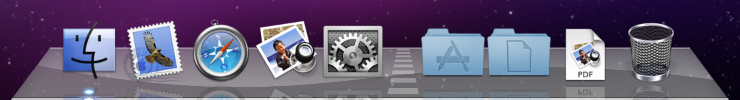

# Snow Leopard

A Mac OS X 10.6 desktop for Linux, written in C++ with Qt 6, cairo and pango. It contains no Apple code:
the resources (icons, fonts, desktop pictures, nibs, strings) are read from your own Snow Leopard install DVD.


## Screenshots

| | |
|---|---|
|  |  |
|  |  |

## Features

- Menu bar: Apple menu, application menus (global menu over D-Bus), Spotlight, clock, battery and volume
- Dock: glass floor, magnification, Stacks, drag and drop, Trash
- Window manager and compositor: 10.6 title bars, buttons and shadows
- Finder: desktop, icon, list, column and Cover Flow views, Get Info, View Options, copy and move, `.DS_Store` support
- System Preferences: all panes, Desktop & Screen Saver
- Preview: PDF and image viewer
- About This Mac
- Mail: IMAP and SMTP (early)
- Linux applications in the Dock and the menu bar

## Requirements

- Linux with X11 or Wayland (tested on CachyOS / Arch Linux)
- A Mac OS X 10.6 Snow Leopard install DVD image
- Build dependencies:

```sh
sudo pacman -S --needed cmake qt6-base qt6-imageformats libxcb xcb-util-keysyms cairo pango libjpeg-turbo libtiff libxkbcommon wayland wayland-protocols poppler-glib 7zip cpio python-xlib
```

## Usage

Run it in a window of your current desktop:

```sh
git clone https://github.com/AshesTom/SnowLarpard.git
cd SnowLarpard
./sl.sh /path/to/snowleopard.iso
```

The first run extracts the DVD files and builds the programs. Later runs: `./sl.sh --`.
A window size can be given: `./sl.sh -- 1600x1000`.

To use it as an X session, add `exec /path/to/session/snowleopard-session` to `~/.xinitrc`.
Restart and Shut Down only act on the computer when `SNOWLEOPARD_POWER=1` is set.

Settings are stored in `~/.config/snowleopard/`, using the Mac's own keys (`dock.conf` for `com.apple.dock`).

## Project layout

| Folder | Contents |
|---|---|
| `shell/src/menubar` | Menu bar (SystemUIServer) |
| `shell/src/dock` | Dock |
| `shell/src/windowserver` | Window manager and compositor |
| `shell/src/finder` | Finder |
| `shell/src/aquakit` | AquaKit, a small AppKit on cairo and pango |
| `shell/src/prefs`, `preview`, `mail`, `loginwindow` | Applications |
| `session/` | X session |
| `tools/extract.py` | DVD extraction |

Documentation: [architecture](docs/architecture.md), [reverse engineering status](docs/reverse-status.md).

## Notice

Experimental, unofficial project, not affiliated with Apple. No Apple files are distributed: you must provide
your own Snow Leopard DVD. Extracted files and the build stay in `.local/`.

## License

LGPL-2.1-or-later, for the code in this repository only. Mac OS X and its resources are copyrighted by Apple.
